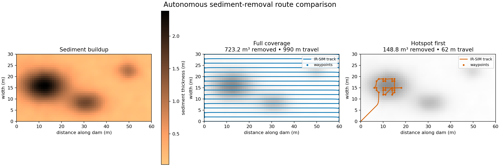

# Dam sediment mapping and removal

This scenario extends IR-SIM with a 2.5D reservoir-bed layer. IR-SIM remains
responsible for horizontal robot navigation; `irsim.sediment` models the
sediment quantity being measured and removed.

The synthetic field contains an inflow delta, a channel-bank deposit and a
smaller dam-adjacent mound. A virtual sounding sensor reports sediment
thickness with configurable Gaussian noise and dropout. Missing samples remain
unknown instead of becoming zero.

Two autonomous strategies are compared:

- **Full coverage:** alternating survey/removal transects.
- **Hotspot first:** a shorter route through the deepest mapped cells.



Run from the repository root:

```bash
python usage/27sediment_dam/sediment_dam.py
```

The script loads `sediment_dam.yaml`, drives an IR-SIM omnidirectional robot
through each route, and plots the simulated tracks over the sediment field. It
also reports travel distance, removed volume, mapped fraction, sample count and
a comparative energy index. The index is for comparing routes; it is not a
physical battery-energy model. Sediment buildup is synthetic and the removal
model is intentionally simplified—it does not model fluid flow, resuspension,
turbidity, disposal, pump curves or permitting constraints.